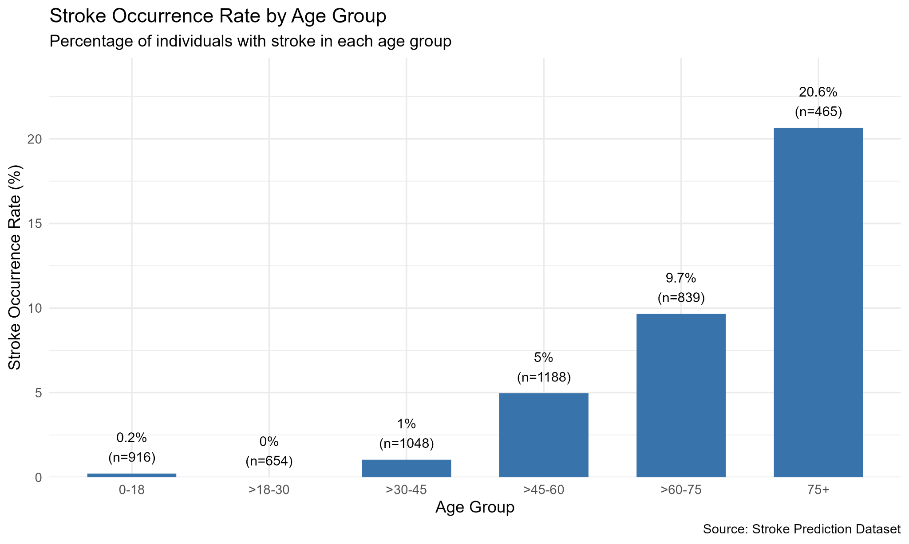
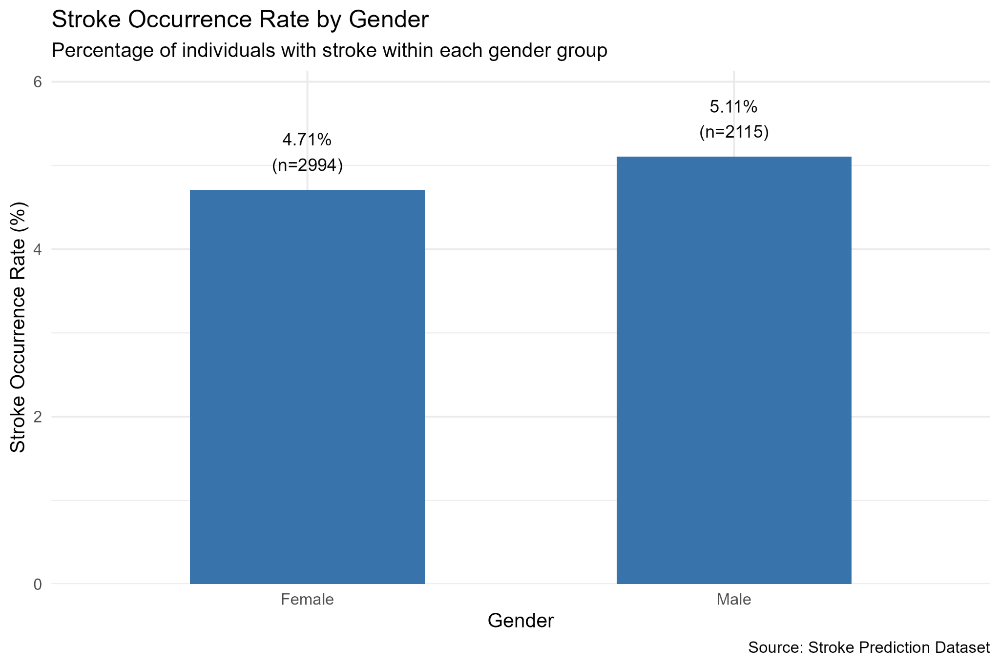
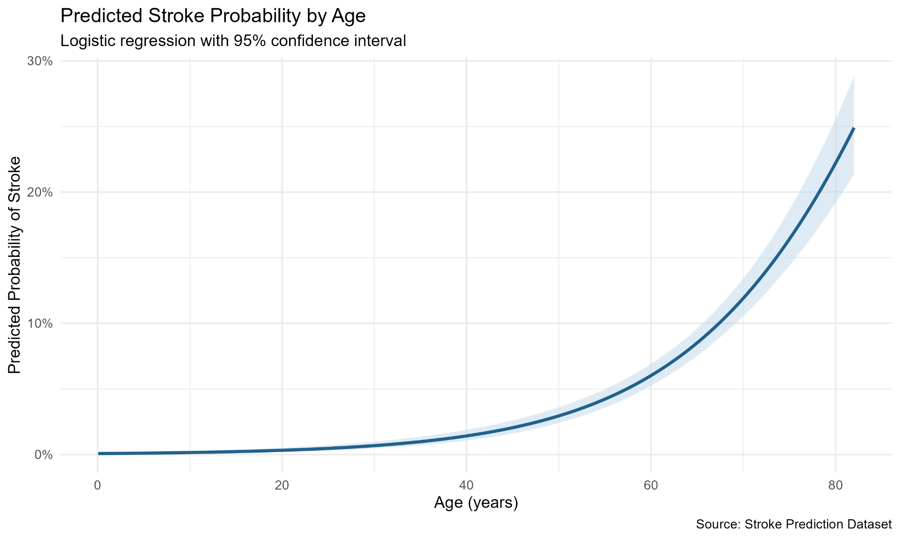
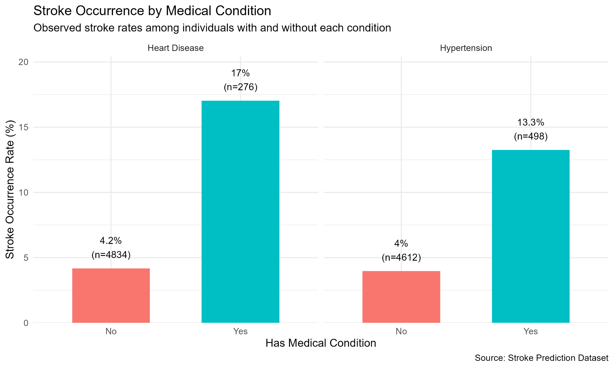
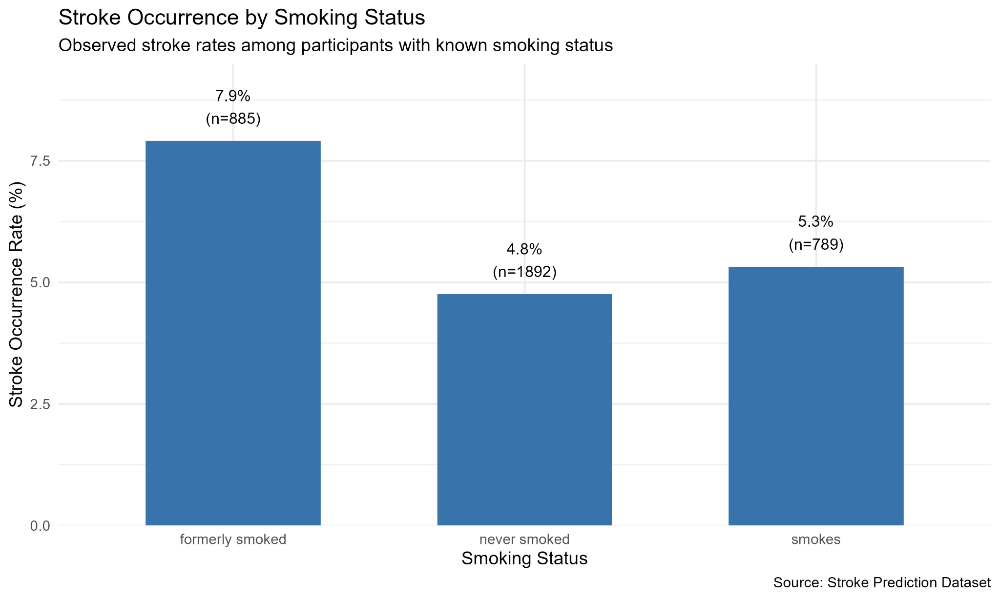
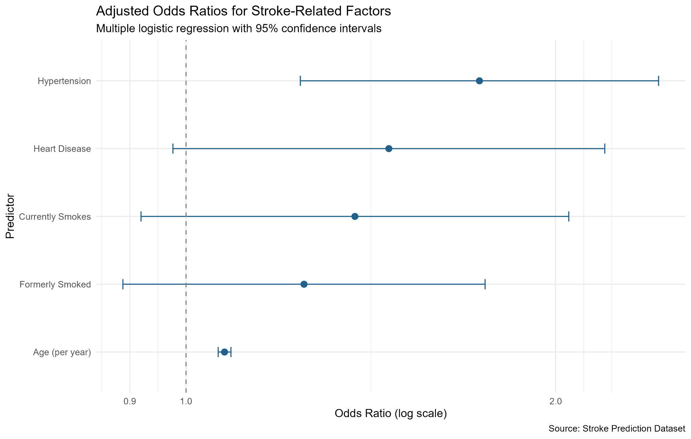

# Stroke Risk Analysis Using R

I used R to explore how age, gender, hypertension, heart disease, and smoking status are associated with stroke in a public stroke prediction dataset. The goal was to answer practical questions with clear charts and statistical analysis, rather than just compare raw counts.

This repository contains an expanded, reproducible analysis built from coursework. It includes the R script, visualizations, and summary results.

## Questions I explored

1. How do stroke occurrence rates differ by age and gender?
2. How does age relate to stroke occurrence, and what does a simple logistic regression show?
3. How are hypertension, heart disease, and smoking status associated with stroke, including after adjusting for age?

## Dataset and preparation

The dataset contains **5,110 records** and includes age, gender, hypertension, heart disease, smoking status, and a stroke indicator. I checked the data structure, missing values, duplicate IDs, and stroke counts. I also created age groups to make the comparisons easier to understand.

The source data uses `Unknown` for some smoking-status values. I treated these as missing for smoking-related analysis rather than assigning them to a smoking category. The full dataset is used for the age and medical-condition summaries, while the smoking comparison and adjusted regression use records with known smoking status. There are also missing BMI values, but BMI is not a predictor in the models shown here.

**Data source:** [Stroke Prediction Dataset](https://www.kaggle.com/datasets/fedesoriano/stroke-prediction-dataset) by fedesoriano on Kaggle. The CSV is not included in this repository. Download it and save it as `data/healthcare-dataset-stroke-data.csv`.

## Tools and methods

- R, dplyr, ggplot2
- Data checking and cleaning
- Grouped summaries and percentage comparisons
- Welch's t-test for comparing ages between stroke groups
- Logistic regression and adjusted odds ratios
- 95% confidence intervals and data visualization

## Results and visualizations

### 1. Stroke occurrence by age group

Stroke occurrence rises across the older age groups. The highest observed rate is **20.6% among participants aged over 75**. These percentages describe this dataset and should not be interpreted as population-level stroke risks.

### 2. Stroke occurrence by gender

The observed stroke rate is **5.11% for males** and **4.71% for females**. The difference is relatively small, and the chart alone does not show whether gender independently predicts stroke. After adjusting for age in a logistic regression, the odds ratio for males versus females was about **1.12 (95% CI 0.86–1.47)**, so gender was not a clear independent predictor in this dataset.

### 3. Age and predicted stroke probability

People who had a stroke averaged **67.7 years old versus 42.0** for those who did not, a difference of about 25.8 years (95% CI 24.1–27.5; Welch's t-test, p < 0.001).

A logistic regression using age as the predictor shows an increasing fitted probability of stroke at older ages. The shaded area shows a **95% confidence interval for the fitted mean probability**, not a prediction interval for an individual.

### 4. Hypertension and heart disease

The observed stroke rate is **13.3% with hypertension versus 4.0% without it**, and **17.0% with heart disease versus 4.2% without it**. These are unadjusted comparisons, so age and other factors may explain part of the difference.

### 5. Smoking status

Among participants with known smoking status, observed stroke rates are **7.9% for former smokers**, **5.3% for current smokers**, and **4.8% for never smokers**. These groups may differ in age and health history, so the percentages do not establish that smoking status caused the differences.

### 6. Adjusted odds ratios

The multiple logistic regression (n = 3,566 records with known smoking status) includes age, hypertension, heart disease, and smoking status. Estimated adjusted odds ratios are:

| Predictor | Adjusted odds ratio | 95% confidence interval |
| --- | ---: | ---: |
| Age (per year) | 1.075 | 1.062–1.088 |
| Hypertension | 1.734 | 1.239–2.426 |
| Heart disease | 1.463 | 0.976–2.193 |
| Formerly smoked (vs. never smoked) | 1.248 | 0.888–1.752 |
| Currently smokes (vs. never smoked) | 1.373 | 0.919–2.050 |

In this model, age and hypertension have confidence intervals entirely above 1. The intervals for heart disease and smoking status include 1, so their adjusted associations are less certain. **Odds ratios are not the same as changes in probability.**

## What I learned

The clearest pattern is the association between older age and stroke occurrence. Hypertension also remains associated with higher stroke odds after adjustment. Comparing the raw smoking and heart-disease percentages with the adjusted model shows why it is important to consider other variables before drawing conclusions.

## Limitations

- This is an observational dataset; the analysis cannot establish causation.
- Stroke cases are a small minority of the dataset, and some subgroup estimates may be unstable.
- Missing or unknown smoking status reduces the sample used in some analyses.
- The models do not include every possible confounding factor and have not been validated for clinical use.
- The fitted probabilities are illustrative results from this dataset, **not a medical screening tool**.

## How to run the analysis

1. Install R and RStudio, if needed.
2. Install the packages `dplyr`, `ggplot2`, and `scales`.
3. Download or clone this repository.
4. Download the dataset from Kaggle (link above) and save it as `data/healthcare-dataset-stroke-data.csv` inside the repository folder.
5. In RStudio, set the working directory to the downloaded `stroke-risk-analysis-r` folder (or open that folder as an RStudio project).
6. Open `stroke_risk_analysis.R` and select **Source**.

The script reads `data/healthcare-dataset-stroke-data.csv`, saves charts in `visualizations/`, and writes summary CSV files to `results/`. It also creates `data/stroke_clean.csv` when run.

## Repository contents

- `stroke_risk_analysis.R` — complete R analysis
- `data/` — place the downloaded Kaggle dataset here (not included)
- `visualizations/` — six charts
- `results/` — age statistics and regression results

## About

Rakesh Boindla — M.S. Information Systems, The Catholic University of America.
